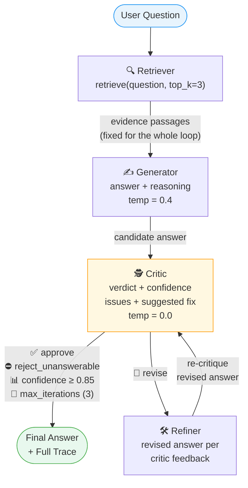
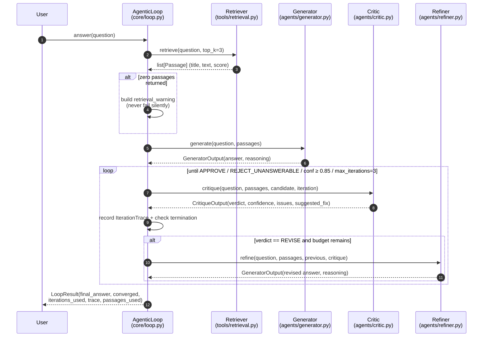
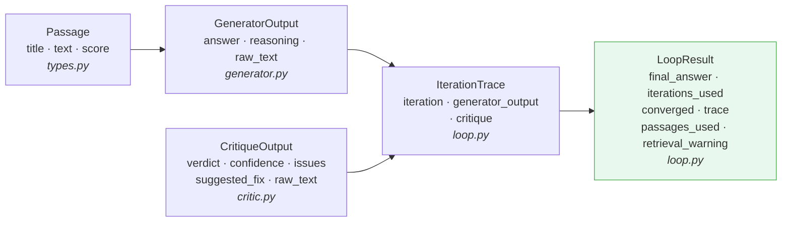

# CRITIC — RAG Flow Reference

> End-to-end documentation of how Retrieval-Augmented Generation works in this
> project: retrieval backends, evidence flow, the Generator → Critic → Refiner
> self-correction loop, and termination conditions.

---

## 1. High-Level Architecture



The system is **RAG wrapped in a self-correction loop**: retrieval grounds every
answer in evidence, and the Critic independently verifies the Generator's output
against that same evidence before it is shown to the user.

The system is **RAG wrapped in a self-correction loop**: retrieval grounds every
answer in evidence, and the Critic independently verifies the Generator's output
against that same evidence before it is shown to the user.

---

## 2. End-to-End Flow (as implemented)



### Step 1 — Retrieval (`core/loop.py` → `AgenticLoop.answer()`)

- The question is passed to the active retriever:
  `retriever.retrieve(question, top_k=SETTINGS.top_k_passages)` (default `top_k=3`).
- The retriever returns a sorted `list[Passage]`, where each passage is
  `Passage(title, text, score)`.
- If **zero** passages come back, a `retrieval_warning` is built explaining *why*
  (question outside the local corpus / web search disabled / API key missing) —
  the system never fails silently.
- ⚠️ Retrieval happens **once per question**. The evidence set stays fixed for
  the whole loop; only the *answer* is revised, never re-retrieved.

### Step 2 — Generation (`agents/generator.py` → `GeneratorAgent.generate()`)

- Prompt = question + evidence block formatted as `[i] title: text`.
- System prompt enforces grounding:
  *"Answer using ONLY the evidence provided; if the evidence is insufficient,
  say so explicitly in your reasoning rather than guessing."*
- LLM call at `temperature = 0.4`, expects JSON:
  `{"reasoning": "...", "answer": "..."}`.
- Malformed JSON degrades gracefully (raw text becomes the answer; the loop
  never crashes).

### Step 3 — Critique (`agents/critic.py` → `CriticAgent.critique()`)

- Sees the **same** question + **same** evidence + the candidate answer and
  its reasoning.
- System prompt enforces evidence-only judgment:
  *"Judge strictly against the evidence provided, not your own outside knowledge."*
- LLM call at `temperature = 0.0`, expects JSON:
  ```json
  {
    "verdict": "approve" | "revise" | "reject_unanswerable",
    "confidence": 0.0-1.0,
    "issues": ["problem found", "..."],
    "suggested_fix": "concrete fix guidance or null"
  }
  ```
- Parse failure **fails safe**: defaults to `REVISE` with confidence `0.0`
  (an unparsable critique can never silently approve a bad answer).

### Step 4 — Termination Check (`core/loop.py`)

The loop stops on **any one** of these conditions (checked in order):

| # | Condition | Result flag |
|---|-----------|-------------|
| 1 | Critic verdict is `APPROVE` | `converged = true` |
| 2 | Critic verdict is `REJECT_UNANSWERABLE` | `converged = false` |
| 3 | Critic confidence ≥ `0.85` (`confidence_stop_threshold`) | — |
| 4 | `iteration == max_iterations` (default `3`, budget exhausted) | returns best-so-far answer |

On stop, a `LoopResult` is returned containing: `final_answer`,
`iterations_used`, `converged`, the full `trace` (one `IterationTrace` per
iteration), `passages_used`, and any `retrieval_warning`.

### Step 5 — Refinement (`agents/refiner.py` → `RefinerAgent.refine()`)

Only reached when the verdict was `REVISE` and no stop condition fired.

- Input: question + evidence + previous answer/reasoning + critic `issues`
  + critic `suggested_fix`.
- Produces a revised `{reasoning, answer}` that directly addresses every issue,
  still grounded strictly in the evidence.
- Flow returns to **Step 3** (the revised answer is critiqued again).

---

## 3. Retrieval Backends

All four backends implement the same protocol
(`tools/retrieval.py`): `retrieve(query, top_k=3) -> list[Passage]`.

| Backend | Class | Algorithm | Selected by |
|---|---|---|---|
| **Vector DB** *(default)* | `VectorCorpusRetriever` | Dense **TF-IDF** vector space model + **cosine similarity**: `Sim(q,d) = (q·d)/(‖q‖·‖d‖)` | `AGENTICLOOPQA_RETRIEVER_TYPE=vector` |
| **Hybrid RAG** | `HybridRetriever` | **Reciprocal Rank Fusion (RRF)**: `Score(d) = Σ 1/(k + rank_m(d))` with `rrf_k = 60`; fuses vector + keyword ranks (each fetched at `top_k × 2`, then merged) | `AGENTICLOOPQA_RETRIEVER_TYPE=hybrid` |
| **Live Web** | `WebSearchRetriever` | Tavily API (if `TAVILY_API_KEY` set) → falls back to DuckDuckGo Instant Answers | `AGENTICLOOPQA_RETRIEVER_TYPE=web` or presence of `TAVILY_API_KEY` |
| **Sparse keyword** | `LocalCorpusRetriever` | Bag-of-words overlap with length normalization: `overlap / len(doc_terms)^0.3` | `AGENTICLOOPQA_RETRIEVER_TYPE=local` |

### Embeddings — what is actually used

- **No neural embeddings at runtime.** The "Vector DB" retriever is a classic
  **TF-IDF sparse vector model** built from scratch (no sentence-transformers,
  no external embedding API, no FAISS):
  - Tokenization: lowercase `[a-z0-9]+`, ~35 stopwords removed
  - TF weight: `1 + log(count)`
  - IDF weight: `log((N+1)/(df+1)) + 1`
  - Scoring: cosine similarity over term vectors; doc vectors + L2 norms
    precomputed at init
- **Planned (docs only, not implemented):** the pgvector schema in
  [SQL_DATABASE.md](SQL_DATABASE.md) specifies a `passage_embeddings` table with
  **OpenAI `text-embedding-3-small` (1536-dim)** vectors, cosine distance, and an
  **HNSW index** (`m=16, ef_construction=64`).

### Knowledge Base

- Default corpus: `agentic_loop_qa/data/local_corpus.json` — 12 hand-written
  fact passages (Eiffel Tower, Mount Everest, water boiling point, Python,
  Great Wall, photosynthesis, Amazon River, Leonardo da Vinci, speed of light,
  United Nations, DNA structure, Sahara Desert).
- Overridable via `AGENTICLOOPQA_CORPUS`.

---

## 4. Concrete Walk-Through

Question: `"Who designed the Eiffel Tower?"`

1. **Retrieve** — TF-IDF cosine ranking puts the *Eiffel Tower* passage first
   (e.g. scores `1.41`, `0.98`, …); top-3 passages selected.
2. **Generate** — LLM answers `"Gustave Eiffel"`, citing passage `[1]`.
3. **Critique** — evidence explicitly names Gustave Eiffel →
   verdict `approve`, confidence `0.97`.
4. **Stop** — confidence `0.97 ≥ 0.85` → return
   `final_answer="Gustave Eiffel"`, `converged=true`, `iterations_used=1`.

Failure case: if the Generator hallucinated a wrong date, the Critic would
return `revise` with an issue like *"the date 1930 is not in the evidence"* →
Refiner corrects it → critique again → typically converges by iteration 2.

---

## 5. Configuration Knobs (`config.py`)

| Setting | Env var | Default | Purpose |
|---|---|---|---|
| `retriever_type` | `AGENTICLOOPQA_RETRIEVER_TYPE` | `vector` | `vector` / `hybrid` / `web` / `local` |
| `top_k_passages` | `AGENTICLOOPQA_TOP_K` | `3` | Passages retrieved per question |
| `local_corpus_path` | `AGENTICLOOPQA_CORPUS` | `.../data/local_corpus.json` | Path to local JSON corpus |
| `max_iterations` | `AGENTICLOOPQA_MAX_ITERS` | `3` | Self-correction loop budget |
| `confidence_stop_threshold` | `AGENTICLOOPQA_STOP_CONF` | `0.85` | Early-stop confidence |
| `temperature_generate` | `AGENTICLOOPQA_TEMP_GEN` | `0.4` | Generator sampling temp |
| `temperature_critique` | `AGENTICLOOPQA_TEMP_CRITIC` | `0.0` | Critic sampling temp |
| `tavily_api_key` | `TAVILY_API_KEY` | — | Enables live web retrieval |

---

## 6. Key Design Points

- **Retrieve once, critique many** — retrieval is a single pass per question;
  the loop rewrites the *answer*, never the evidence set, keeping critique
  grounded against a stable evidence base.
- **Grounding enforced at every step** — Generator, Critic, and Refiner all
  receive the identical evidence block and are instructed to use only it.
  The Critic is the anti-hallucination gate, which is exactly what the
  benchmarks in `critic/` measure (hallucination reduction + RRF significance).
- **Bounded loop** — four termination conditions guarantee termination; budget
  exhaustion returns the best-so-far answer rather than failing.
- **Fail-safe parsing** — malformed Critic output can never approve an answer;
  malformed Generator/Refiner output degrades to raw text instead of crashing.
- **Full auditability** — every iteration is captured in `IterationTrace`
  (answer, reasoning, verdict, confidence, issues, suggested fix) and returned
  via `LoopResult.to_dict()` — consumed by the Web UI dashboard and the
  Temporal persistence pipeline.

---

## 7. Data Flow Summary



---

## Related Documentation Files

- [PROJECT_OVERVIEW.md](PROJECT_OVERVIEW.md) — Architectural overview, modes, and directory setup.
- [BACKEND.md](BACKEND.md) — Backend engine, agents, and evaluation framework.
- [SQL_DATABASE.md](SQL_DATABASE.md) — Relational + pgvector schema (incl. planned `text-embedding-3-small` embeddings).
- [APIS.md](APIS.md) — Python, JSON schema, CLI, REST, and WebSocket API contracts.
- [TEMPORAL_PIPELINE.md](TEMPORAL_PIPELINE.md) — Durable execution pipeline for the agent loop.
