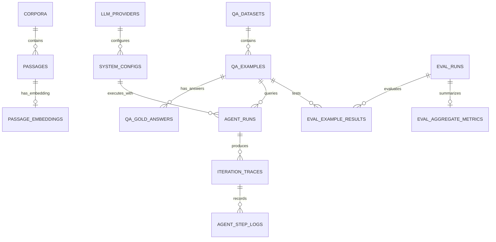

# CriticRAG AI — Database Architecture & SQL Schema Reference

> Comprehensive relational and vector database documentation, Entity-Relationship Diagrams (ERD), DDL SQL schemas for all system components, indexing strategies, and analytical queries.

---

## 1. Database Architecture & Entity-Relationship Overview

The database design for CriticRAG AI supports persistence for all 5 core system domains:
1. **Configuration & Provider Settings Component** (`system_configs`, `llm_providers`)
2. **Retrieval & Knowledge Base Component** (`corpora`, `passages`, `passage_embeddings`)
3. **QA Datasets & Ground Truth Component** (`qa_datasets`, `qa_examples`, `qa_gold_answers`)
4. **Agentic Reasoning & Execution Engine Component** (`agent_runs`, `iteration_traces`, `agent_step_logs`)
5. **Evaluation & Metrics Benchmarking Component** (`eval_runs`, `eval_example_results`, `eval_aggregate_metrics`)



---

## 2. Complete DDL SQL Schemas for Each Component

*Compatible with PostgreSQL 15+ and the `pgvector` extension.*

```sql
-- Enable UUID and Vector extensions
CREATE EXTENSION IF NOT EXISTS "uuid-ossp";
CREATE EXTENSION IF NOT EXISTS "vector";
```

### Component 1: Configuration & LLM Providers

```sql
-- Table: llm_providers
CREATE TABLE llm_providers (
    id UUID PRIMARY KEY DEFAULT uuid_generate_v4(),
    provider_name VARCHAR(50) NOT NULL UNIQUE, -- e.g., 'anthropic', 'openai', 'mock'
    api_base_url VARCHAR(255),
    is_active BOOLEAN NOT NULL DEFAULT TRUE,
    created_at TIMESTAMP WITH TIME ZONE DEFAULT CURRENT_TIMESTAMP
);

-- Table: system_configs
CREATE TABLE system_configs (
    id UUID PRIMARY KEY DEFAULT uuid_generate_v4(),
    config_name VARCHAR(100) NOT NULL UNIQUE,
    llm_provider_id UUID REFERENCES llm_providers(id) ON DELETE SET NULL,
    model_name VARCHAR(100) NOT NULL DEFAULT 'claude-3-5-sonnet-20241022',
    max_iterations INT NOT NULL DEFAULT 3 CHECK (max_iterations >= 1),
    confidence_stop_threshold NUMERIC(3, 2) NOT NULL DEFAULT 0.85 CHECK (confidence_stop_threshold BETWEEN 0.0 AND 1.0),
    top_k_passages INT NOT NULL DEFAULT 3 CHECK (top_k_passages >= 1),
    mock_mode BOOLEAN NOT NULL DEFAULT FALSE,
    created_at TIMESTAMP WITH TIME ZONE DEFAULT CURRENT_TIMESTAMP,
    updated_at TIMESTAMP WITH TIME ZONE DEFAULT CURRENT_TIMESTAMP
);
```

---

### Component 2: Retrieval & Knowledge Base

```sql
-- Table: corpora
CREATE TABLE corpora (
    id UUID PRIMARY KEY DEFAULT uuid_generate_v4(),
    name VARCHAR(100) NOT NULL UNIQUE,
    description TEXT,
    is_default BOOLEAN DEFAULT FALSE,
    created_at TIMESTAMP WITH TIME ZONE DEFAULT CURRENT_TIMESTAMP
);

-- Table: passages
CREATE TABLE passages (
    id UUID PRIMARY KEY DEFAULT uuid_generate_v4(),
    corpus_id UUID NOT NULL REFERENCES corpora(id) ON DELETE CASCADE,
    title VARCHAR(255) NOT NULL,
    text TEXT NOT NULL,
    metadata JSONB DEFAULT '{}'::jsonb,
    created_at TIMESTAMP WITH TIME ZONE DEFAULT CURRENT_TIMESTAMP
);

-- Table: passage_embeddings (pgvector support)
CREATE TABLE passage_embeddings (
    passage_id UUID PRIMARY KEY REFERENCES passages(id) ON DELETE CASCADE,
    embedding VECTOR(1536), -- 1536-dimensional vector for dense retrieval
    model_name VARCHAR(100) NOT NULL DEFAULT 'text-embedding-3-small',
    created_at TIMESTAMP WITH TIME ZONE DEFAULT CURRENT_TIMESTAMP
);
```

---

### Component 3: QA Datasets & Benchmark Examples

```sql
-- Table: qa_datasets
CREATE TABLE qa_datasets (
    id UUID PRIMARY KEY DEFAULT uuid_generate_v4(),
    dataset_name VARCHAR(100) NOT NULL UNIQUE,
    description TEXT,
    created_at TIMESTAMP WITH TIME ZONE DEFAULT CURRENT_TIMESTAMP
);

-- Table: qa_examples
CREATE TABLE qa_examples (
    id UUID PRIMARY KEY DEFAULT uuid_generate_v4(),
    dataset_id UUID NOT NULL REFERENCES qa_datasets(id) ON DELETE CASCADE,
    external_id VARCHAR(100),
    question TEXT NOT NULL,
    created_at TIMESTAMP WITH TIME ZONE DEFAULT CURRENT_TIMESTAMP
);

-- Table: qa_gold_answers
CREATE TABLE qa_gold_answers (
    id UUID PRIMARY KEY DEFAULT uuid_generate_v4(),
    example_id UUID NOT NULL REFERENCES qa_examples(id) ON DELETE CASCADE,
    gold_answer TEXT NOT NULL
);
```

---

### Component 4: Agentic Reasoning Engine & Execution Runs

```sql
-- Table: agent_runs
CREATE TABLE agent_runs (
    id UUID PRIMARY KEY DEFAULT uuid_generate_v4(),
    config_id UUID REFERENCES system_configs(id) ON DELETE SET NULL,
    example_id UUID REFERENCES qa_examples(id) ON DELETE SET NULL,
    question TEXT NOT NULL,
    final_answer TEXT,
    iterations_used INT NOT NULL DEFAULT 0,
    converged BOOLEAN NOT NULL DEFAULT FALSE,
    execution_time_ms INT,
    created_at TIMESTAMP WITH TIME ZONE DEFAULT CURRENT_TIMESTAMP
);

-- Table: iteration_traces
CREATE TABLE iteration_traces (
    id UUID PRIMARY KEY DEFAULT uuid_generate_v4(),
    run_id UUID NOT NULL REFERENCES agent_runs(id) ON DELETE CASCADE,
    iteration_number INT NOT NULL,
    generator_answer TEXT NOT NULL,
    generator_reasoning TEXT NOT NULL,
    critic_verdict VARCHAR(30) NOT NULL CHECK (critic_verdict IN ('approve', 'revise', 'reject_unanswerable')),
    critic_confidence NUMERIC(3, 2) NOT NULL CHECK (critic_confidence BETWEEN 0.0 AND 1.0),
    critic_issues JSONB DEFAULT '[]'::jsonb,
    critic_suggested_fix TEXT,
    created_at TIMESTAMP WITH TIME ZONE DEFAULT CURRENT_TIMESTAMP,
    UNIQUE (run_id, iteration_number)
);

-- Table: agent_step_logs (raw prompts and completions for auditing)
CREATE TABLE agent_step_logs (
    id UUID PRIMARY KEY DEFAULT uuid_generate_v4(),
    iteration_trace_id UUID NOT NULL REFERENCES iteration_traces(id) ON DELETE CASCADE,
    agent_type VARCHAR(20) NOT NULL CHECK (agent_type IN ('generator', 'critic', 'refiner')),
    system_prompt TEXT NOT NULL,
    user_prompt TEXT NOT NULL,
    raw_completion TEXT NOT NULL,
    temperature NUMERIC(3, 2) NOT NULL,
    created_at TIMESTAMP WITH TIME ZONE DEFAULT CURRENT_TIMESTAMP
);
```

---

### Component 5: Evaluation & Metrics Benchmarking

```sql
-- Table: eval_runs
CREATE TABLE eval_runs (
    id UUID PRIMARY KEY DEFAULT uuid_generate_v4(),
    dataset_id UUID NOT NULL REFERENCES qa_datasets(id) ON DELETE CASCADE,
    config_id UUID REFERENCES system_configs(id) ON DELETE SET NULL,
    total_examples INT NOT NULL,
    created_at TIMESTAMP WITH TIME ZONE DEFAULT CURRENT_TIMESTAMP
);

-- Table: eval_example_results
CREATE TABLE eval_example_results (
    id UUID PRIMARY KEY DEFAULT uuid_generate_v4(),
    eval_run_id UUID NOT NULL REFERENCES eval_runs(id) ON DELETE CASCADE,
    example_id UUID NOT NULL REFERENCES qa_examples(id) ON DELETE CASCADE,
    baseline_answer TEXT NOT NULL,
    baseline_em NUMERIC(3, 2) NOT NULL,
    baseline_f1 NUMERIC(3, 2) NOT NULL,
    loop_answer TEXT NOT NULL,
    loop_em NUMERIC(3, 2) NOT NULL,
    loop_f1 NUMERIC(3, 2) NOT NULL,
    answer_changed BOOLEAN NOT NULL,
    iterations_used INT NOT NULL
);

-- Table: eval_aggregate_metrics
CREATE TABLE eval_aggregate_metrics (
    eval_run_id UUID PRIMARY KEY REFERENCES eval_runs(id) ON DELETE CASCADE,
    baseline_em_avg NUMERIC(5, 4) NOT NULL,
    baseline_f1_avg NUMERIC(5, 4) NOT NULL,
    loop_em_avg NUMERIC(5, 4) NOT NULL,
    loop_f1_avg NUMERIC(5, 4) NOT NULL,
    em_improvement_delta NUMERIC(5, 4) NOT NULL,
    f1_improvement_delta NUMERIC(5, 4) NOT NULL,
    change_rate NUMERIC(5, 4) NOT NULL,
    average_iterations NUMERIC(4, 2) NOT NULL
);
```

---

## 3. Indexing Strategy for High-Performance Queries

```sql
-- Indexes for Fast Foreign Key Lookups & Time-Series Sorting
CREATE INDEX idx_passages_corpus_id ON passages(corpus_id);
CREATE INDEX idx_qa_examples_dataset_id ON qa_examples(dataset_id);
CREATE INDEX idx_agent_runs_created_at ON agent_runs(created_at DESC);
CREATE INDEX idx_iteration_traces_run_id ON iteration_traces(run_id);

-- GIN Index for Fast Search over Critic Issues JSONB Array
CREATE INDEX idx_critic_issues_gin ON iteration_traces USING GIN (critic_issues);

-- HNSW Vector Index for Dense Semantic Search (pgvector)
CREATE INDEX idx_passage_embeddings_hnsw 
ON passage_embeddings 
USING hnsw (embedding vector_cosine_ops)
WITH (m = 16, ef_construction = 64);
```

---

## 4. Sample Operational & Analytical SQL Queries

### Query 1: Fetch Full Multi-Agent Reasoning Trace for a Given Run
```sql
SELECT 
    r.question,
    r.final_answer,
    r.converged,
    t.iteration_number,
    t.generator_answer,
    t.generator_reasoning,
    t.critic_verdict,
    t.critic_confidence,
    t.critic_issues,
    t.critic_suggested_fix
FROM agent_runs r
JOIN iteration_traces t ON r.id = t.run_id
WHERE r.id = 'a1b2c3d4-e5f6-7890-abcd-1234567890ab'
ORDER BY t.iteration_number ASC;
```

---

### Query 2: Calculate Iteration Convergence Rate by LLM Model
```sql
SELECT 
    c.model_name,
    COUNT(r.id) AS total_runs,
    ROUND(AVG(r.iterations_used), 2) AS avg_iterations,
    ROUND(SUM(CASE WHEN r.converged THEN 1 ELSE 0 END)::DECIMAL / COUNT(r.id) * 100, 2) AS convergence_rate_pct
FROM agent_runs r
JOIN system_configs c ON r.config_id = c.id
GROUP BY c.model_name;
```

---

### Query 3: Evaluation Benchmark Metrics Comparison (Baseline vs. Loop)
```sql
SELECT 
    er.id AS eval_run_id,
    d.dataset_name,
    m.baseline_em_avg * 100 AS baseline_em_pct,
    m.loop_em_avg * 100 AS loop_em_pct,
    (m.loop_em_avg - m.baseline_em_avg) * 100 AS em_gain_pct,
    m.baseline_f1_avg * 100 AS baseline_f1_pct,
    m.loop_f1_avg * 100 AS loop_f1_pct,
    (m.loop_f1_avg - m.baseline_f1_avg) * 100 AS f1_gain_pct,
    m.change_rate * 100 AS answer_change_rate_pct,
    m.average_iterations
FROM eval_runs er
JOIN qa_datasets d ON er.dataset_id = d.id
JOIN eval_aggregate_metrics m ON er.id = m.eval_run_id
ORDER BY er.created_at DESC;
```

---

## Related Documentation Files

- [PROJECT_OVERVIEW.md](file:///c:/Users/purva/VIT/5th%20SEM/AI/CriticRAG%20AI/PROJECT_OVERVIEW.md) — Architectural overview, modes, and directory setup.
- [BACKEND.md](file:///c:/Users/purva/VIT/5th%20SEM/AI/CriticRAG%20AI/BACKEND.md) — Backend engine, agents, and evaluation framework.
- [FRONTEND.md](file:///c:/Users/purva/VIT/5th%20SEM/AI/CriticRAG%20AI/FRONTEND.md) — CLI output format and Web UI visual dashboard spec.
- [APIS.md](file:///c:/Users/purva/VIT/5th%20SEM/AI/CriticRAG%20AI/APIS.md) — Python, JSON schema, CLI, REST, and WebSocket API contracts.
