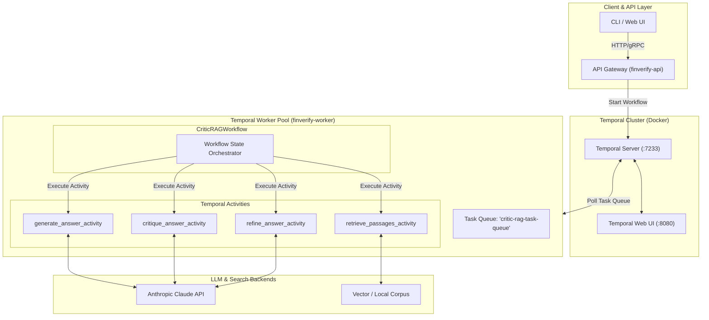
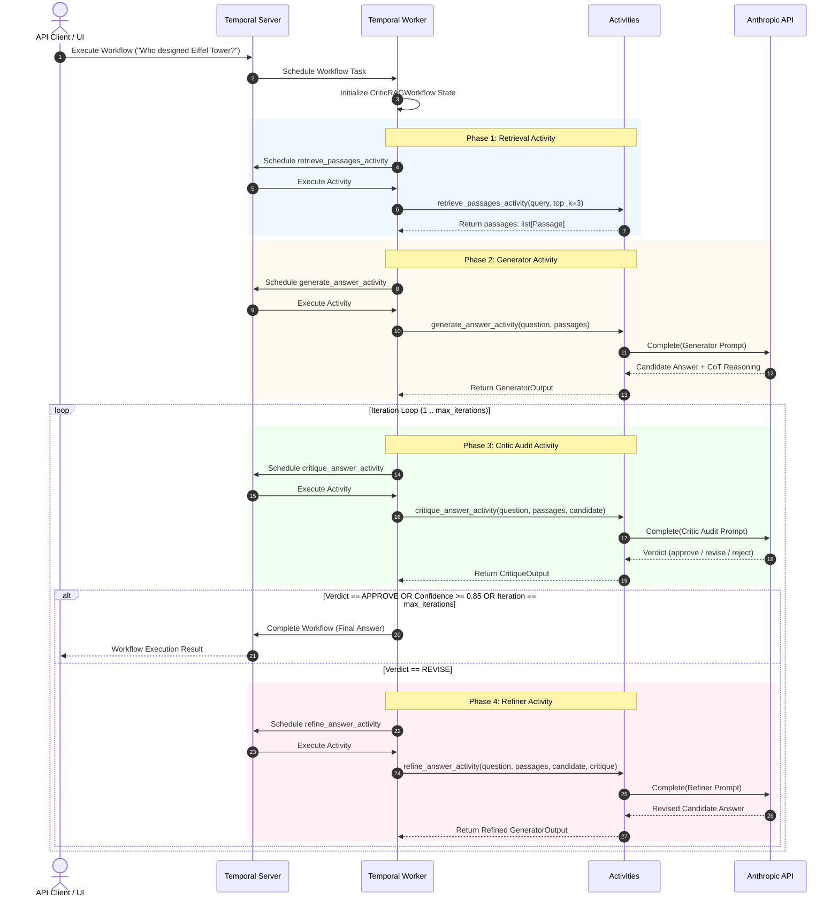

# Temporal Workflow Pipeline & Implementation Guide

> **Durable Multi-Agent Orchestration, Fault-Tolerant State Persistence, Retry Policies, and Real-Time Workflow Monitoring using Temporal.io**

---

## 1. Executive Summary & Architecture Overview

Integrating **Temporal.io** into CriticRAG AI upgrades the multi-agent reasoning loop from a standard in-memory script into a **durable, fault-tolerant workflow**. 

### Key Benefits of Temporal in Agentic RAG
1. **Durable State Execution**: If a container crashes mid-iteration, Temporal resumes the workflow from the exact agent step without losing state or re-billing LLM API tokens.
2. **Automatic Rate Limit & Failure Retries**: Anthropic API rate limits (`429 Too Many Requests`) or network timeouts automatically trigger exponential backoff retry policies managed by Temporal workers.
3. **Human-in-the-Loop Signals**: Allows human reviewers to send real-time signals (`human_override_verdict`) to modify Critic verdicts or inject human guidance during execution.
4. **Real-Time Workflow Inspection**: Inspect execution traces, activity parameters, step latencies, and state histories via the Temporal Web UI (`http://localhost:8080`).

---

## 2. Temporal Pipeline Architecture Diagrams

### 1. High-Level System Architecture Diagram



---

### 2. Multi-Agent Reasoning Sequence & State Diagram



---

## 3. Complete Python Implementation Code

The implementation is modularized under `agentic_loop_qa/temporal/`.

### 1. Activity Definitions (`agentic_loop_qa/temporal/activities.py`)

```python
"""Temporal Activities for CriticRAG AI."""

from __future__ import annotations
from temporalio import activity

from ..agents.critic import CriticAgent
from ..agents.generator import GeneratorAgent
from ..agents.refiner import RefinerAgent
from ..core.types import CritiqueOutput, GeneratorOutput, Passage
from ..llm_client import LLMClient
from ..tools.retrieval import get_default_retriever
from ..config import SETTINGS


@activity.defn
async def retrieve_passages_activity(question: str, top_k: int = 3) -> list[dict]:
    """Retrieves relevant passages for grounding."""
    retriever = get_default_retriever(SETTINGS.local_corpus_path)
    passages = retriever.retrieve(question, top_k=top_k)
    return [{"title": p.title, "text": p.text, "score": p.score} for p in passages]


@activity.defn
async def generate_answer_activity(question: str, passages_dict: list[dict]) -> dict:
    """Generates initial answer candidate and CoT reasoning."""
    llm = LLMClient()
    generator = GeneratorAgent(llm)
    passages = [Passage(p["title"], p["text"], p["score"]) for p in passages_dict]
    output = generator.generate(question, passages)
    return {"answer": output.answer, "reasoning": output.reasoning, "raw_text": output.raw_text}


@activity.defn
async def critique_answer_activity(
    question: str, passages_dict: list[dict], candidate_dict: dict, iteration: int
) -> dict:
    """Audits candidate answer against retrieved evidence passages."""
    llm = LLMClient()
    critic = CriticAgent(llm)
    passages = [Passage(p["title"], p["text"], p["score"]) for p in passages_dict]
    candidate = GeneratorOutput(candidate_dict["answer"], candidate_dict["reasoning"])
    
    critique = critic.critique(question, passages, candidate, iteration)
    return {
        "verdict": critique.verdict.value,
        "confidence": critique.confidence,
        "issues": critique.issues,
        "suggested_fix": critique.suggested_fix,
        "raw_text": critique.raw_text,
    }


@activity.defn
async def refine_answer_activity(
    question: str, passages_dict: list[dict], candidate_dict: dict, critique_dict: dict
) -> dict:
    """Revises candidate answer using Critic feedback."""
    llm = LLMClient()
    refiner = RefinerAgent(llm)
    passages = [Passage(p["title"], p["text"], p["score"]) for p in passages_dict]
    candidate = GeneratorOutput(candidate_dict["answer"], candidate_dict["reasoning"])
    critique = CritiqueOutput(
        verdict=critique_dict["verdict"],
        confidence=critique_dict["confidence"],
        issues=critique_dict["issues"],
        suggested_fix=critique_dict["suggested_fix"],
    )
    refined = refiner.refine(question, passages, candidate, critique)
    return {"answer": refined.answer, "reasoning": refined.reasoning, "raw_text": refined.raw_text}
```

---

### 2. Workflow Orchestrator (`agentic_loop_qa/temporal/workflow.py`)

```python
"""Temporal Workflow orchestrating the multi-agent self-correction loop."""

from datetime import timedelta
from temporalio import workflow
from temporalio.common import RetryPolicy

with workflow.unsafe.imports_passed_through():
    from .activities import (
        retrieve_passages_activity,
        generate_answer_activity,
        critique_answer_activity,
        refine_answer_activity,
    )

# Exponential Backoff Retry Policy for API rate limits / timeouts
DEFAULT_ACTIVITY_RETRY_POLICY = RetryPolicy(
    initial_interval=timedelta(seconds=1),
    backoff_coefficient=2.0,
    maximum_interval=timedelta(seconds=30),
    maximum_attempts=5,
)


@workflow.defn
class CriticRAGWorkflow:
    def __init__(self) -> None:
        self._current_status: str = "INITIALIZING"
        self._trace: list[dict] = []
        self._human_override_verdict: str | None = None

    @workflow.run
    async def run(self, question: str, max_iterations: int = 3, top_k: int = 3) -> dict:
        self._current_status = "RETRACTING_EVIDENCE"
        passages = await workflow.execute_activity(
            retrieve_passages_activity,
            args=[question, top_k],
            start_to_close_timeout=timedelta(seconds=15),
            retry_policy=DEFAULT_ACTIVITY_RETRY_POLICY,
        )

        self._current_status = "GENERATING_INITIAL_ANSWER"
        current_candidate = await workflow.execute_activity(
            generate_answer_activity,
            args=[question, passages],
            start_to_close_timeout=timedelta(seconds=30),
            retry_policy=DEFAULT_ACTIVITY_RETRY_POLICY,
        )

        for iteration in range(1, max_iterations + 1):
            self._current_status = f"CRITIQUING_ITERATION_{iteration}"
            critique = await workflow.execute_activity(
                critique_answer_activity,
                args=[question, passages, current_candidate, iteration],
                start_to_close_timeout=timedelta(seconds=30),
                retry_policy=DEFAULT_ACTIVITY_RETRY_POLICY,
            )

            # Support optional human signal override
            if self._human_override_verdict:
                critique["verdict"] = self._human_override_verdict
                critique["issues"].append("Verdict overridden by human operator.")

            self._trace.append({
                "iteration": iteration,
                "candidate": current_candidate,
                "critique": critique,
            })

            stop_conditions = (
                critique["verdict"] in ("approve", "reject_unanswerable")
                or critique["confidence"] >= 0.85
                or iteration == max_iterations
            )

            if stop_conditions:
                self._current_status = "COMPLETED"
                return {
                    "question": question,
                    "final_answer": current_candidate["answer"],
                    "iterations_used": iteration,
                    "converged": critique["verdict"] == "approve",
                    "trace": self._trace,
                    "passages": passages,
                }

            self._current_status = f"REFINING_ITERATION_{iteration}"
            current_candidate = await workflow.execute_activity(
                refine_answer_activity,
                args=[question, passages, current_candidate, critique],
                start_to_close_timeout=timedelta(seconds=30),
                retry_policy=DEFAULT_ACTIVITY_RETRY_POLICY,
            )

        return {
            "question": question,
            "final_answer": current_candidate["answer"],
            "iterations_used": max_iterations,
            "converged": False,
            "trace": self._trace,
            "passages": passages,
        }

    @workflow.query
    def get_current_status(self) -> str:
        """Query handler to inspect live workflow status."""
        return self._current_status

    @workflow.query
    def get_current_trace(self) -> list[dict]:
        """Query handler to retrieve real-time trace state."""
        return self._trace

    @workflow.signal
    def human_override_verdict(self, verdict: str) -> None:
        """Signal handler to manually approve or reject candidate answers."""
        self._human_override_verdict = verdict
```

---

### 3. Temporal Worker Process (`agentic_loop_qa/temporal/worker.py`)

```python
"""Worker process polling Temporal server for tasks."""

import asyncio
from temporalio.client import Client
from temporalio.worker import Worker

from .activities import (
    retrieve_passages_activity,
    generate_answer_activity,
    critique_answer_activity,
    refine_answer_activity,
)
from .workflow import CriticRAGWorkflow

TASK_QUEUE = "critic-rag-task-queue"
TEMPORAL_HOST = "localhost:7233"


async def main():
    print(f"Connecting worker to Temporal server at {TEMPORAL_HOST}...")
    client = await Client.connect(TEMPORAL_HOST)

    worker = Worker(
        client,
        task_queue=TASK_QUEUE,
        workflows=[CriticRAGWorkflow],
        activities=[
            retrieve_passages_activity,
            generate_answer_activity,
            critique_answer_activity,
            refine_answer_activity,
        ],
    )
    print(f"Worker listening on task queue: '{TASK_QUEUE}'...")
    await worker.run()


if __name__ == "__main__":
    asyncio.run(main())
```

---

### 4. Client Trigger Script (`agentic_loop_qa/temporal/client.py`)

```python
"""Client script triggering workflow execution via Temporal SDK."""

import asyncio
import uuid
from temporalio.client import Client
from .workflow import CriticRAGWorkflow

TEMPORAL_HOST = "localhost:7233"
TASK_QUEUE = "critic-rag-task-queue"


async def execute_question(question: str):
    client = await Client.connect(TEMPORAL_HOST)
    workflow_id = f"critic-rag-{uuid.uuid4().hex[:8]}"

    print(f"Starting Workflow ID: {workflow_id}")
    result = await client.execute_workflow(
        CriticRAGWorkflow.run,
        args=[question],
        id=workflow_id,
        task_queue=TASK_QUEUE,
    )

    print("\n================ WORKFLOW RESULT ================")
    print(f"Question       : {result['question']}")
    print(f"Final Answer   : {result['final_answer']}")
    print(f"Iterations Used: {result['iterations_used']}")
    print(f"Converged      : {result['converged']}")
    print("=================================================\n")
    return result


if __name__ == "__main__":
    asyncio.run(execute_question("Who designed the Eiffel Tower?"))
```

---

## 4. Monitoring Workflows in Temporal UI (`http://localhost:8080`)

When running Docker Compose (`./start.bash`), the Temporal Web UI is available at `http://localhost:8080`.

### Key Monitoring Features
1. **Workflow History Inspection**: View exact timelines of activity scheduling, completion latencies, and payload inputs/outputs.
2. **Failure & Retry Audit**: Track automatically retried API calls or exceptions without container restarts.
3. **Query Status**: Send live queries (`get_current_status`, `get_current_trace`) while a workflow is in progress.
4. **Signal Dispatch**: Send `human_override_verdict` signals directly from the UI button to influence active execution steps.

---

## Related Documentation Files

- [DOCKER.md](file:///c:/Users/purva/VIT/5th%20SEM/AI/CriticRAG%20AI/DOCKER.md) — Multi-container setup (`finverify-temporal-1`, `finverify-worker-1`).
- [PROJECT_OVERVIEW.md](file:///c:/Users/purva/VIT/5th%20SEM/AI/CriticRAG%20AI/PROJECT_OVERVIEW.md) — High-level architecture and agent roles.
- [BACKEND.md](file:///c:/Users/purva/VIT/5th%20SEM/AI/CriticRAG%20AI/BACKEND.md) — Core agentic self-correction loop logic.
- [ENCRYPTION.md](file:///c:/Users/purva/VIT/5th%20SEM/AI/CriticRAG%20AI/ENCRYPTION.md) — Transport encryption (TLS / gRPC) for Temporal channels.
